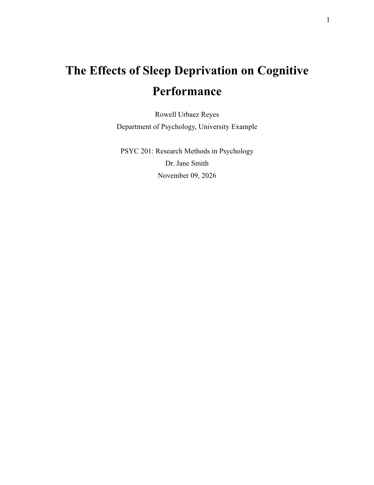
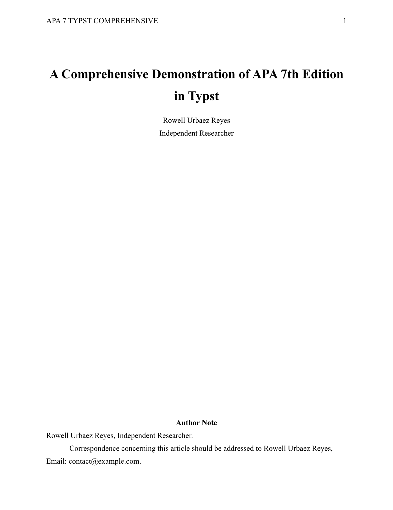
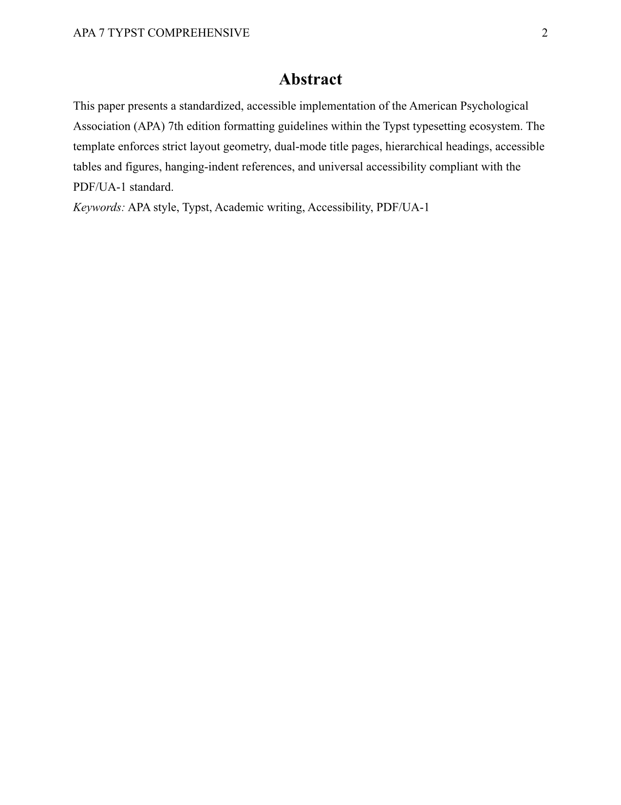
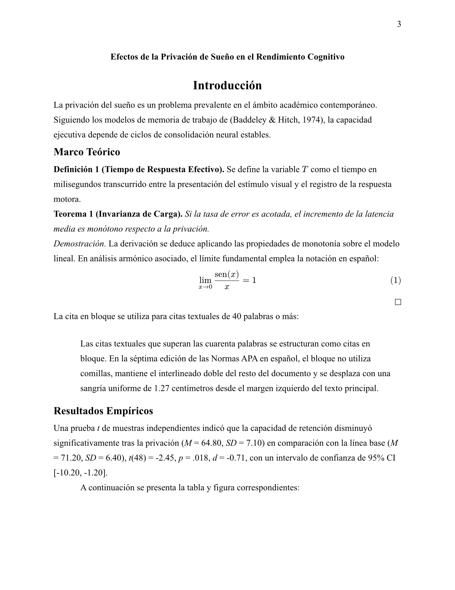
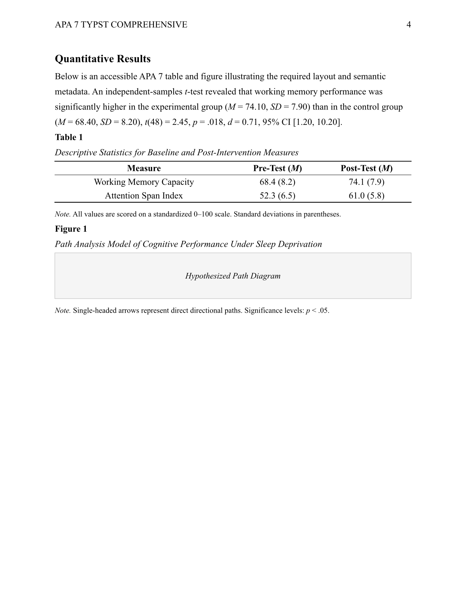

<div align="center">

# apa7

**A modular, standards-compliant, and universally accessible APA 7th Edition framework for Typst.**

[](https://typst.app/)
[](typst.toml)
[](docs/accessibility.md)
[](LICENSE)

</div>

---

## Overview

`apa7` provides a complete, modern implementation of the **American Psychological Association (APA) Style (7th Edition)** for [Typst](https://typst.app/). Designed with modularity, developer ergonomics, and native accessibility in mind, it handles page geometry, typography, dual-mode title pages, 5-level hierarchical headings, accessible tables, figures, abstracts, appendices, statistical reporting, and formal STEM theorems.

---

## 🖼️ Visual Gallery

Rendered directly from the included examples using Typst:

<div align="center">

| Student Title Page | Professional Title Page |
| :---: | :---: |
|  |  |

| Abstract & Keywords | Math & Statistics (APA 7) |
| :---: | :---: |
|  |  |

| Tables and Figures |
| :---: |
|  |

</div>

---

## 📖 Documentation Guides

Explore our comprehensive, low-cognitive-load guides:

- 🚀 **[Getting Started Guide](docs/getting-started.md):** Quickstart, minimal templates, and compilation commands.
- 📚 **[API Reference](docs/api-reference.md):** Full documentation for every exported function, parameter, and helper.
- ♿ **[Accessibility Guide](docs/accessibility.md):** PDF/UA-1 conformance, screen reader shortcuts (NVDA/JAWS), and speech descriptions.
- 📐 **[STEM & Math Guide](docs/stem-and-math.md):** Calculus notation, linear algebra, theorem environments, proofs, and Spanish operators.

---

## Quickstart

```typst
#import "@preview/apa7:0.1.0": *

#show: apa7.with(
  paper-type: "student",
  title: "The Effects of Sleep Deprivation on Cognitive Performance",
  authors: (
    (
      name: "Rowell Urbaez Reyes",
      affiliation: "Department of Psychology, University Example",
    ),
  ),
  course: "PSYC 201: Research Methods in Psychology",
  instructor: "Dr. Jane Smith",
  due-date: datetime(year: 2026, month: 11, day: 9),
  abstract: [
    This study investigates the correlation between chronic sleep restriction and
    short-term working memory retention among undergraduate students...
  ],
  keywords: ("Sleep deprivation", "Cognitive psychology", "Memory retention"),
  lang: "en",
)

= Introduction

Sleep deprivation is a prevalent issue in modern academic environments...
```

---

## Features

- **Strict Page Geometry:** Standard Letter (or A4) dimensions, 1-inch (2.54 cm) margins on all sides, and top-right page numbers.
- **Student & Professional Paper Modes:** Configurable title pages following official APA 7 guidelines for both academic student submissions and peer-reviewed professional manuscripts.
- **APA 7 Headings (Levels 1–5):** Automated formatting for all five heading levels (centering, alignment, bold, italics, indentations, and inline run-in headings).
- **Approved Typography:** Native presets for standard APA fonts (Times New Roman 12pt, Georgia 11pt, Calibri 11pt, Arial 11pt) with double line spacing (200%) and 0.5-inch paragraph indentation.
- **Structured Tables & Figures:** Clean layouts supporting APA numbering, italicized titles, and three-tiered notes (*General*, *Specific*, *Probability*).
- **Abstract & Keywords:** Dedicated unindented abstract page with formatted keywords.
- **Appendices:** Automatic labeling and formatting for supplementary materials with subordinate numbering (`Table A1`).
- **Statistical Reporting (`apa-stat`):** Automatic omission of leading zeros for bounded statistics ($p, r, \eta_p^2$), formatted confidence intervals, and $t$/$F$/$\chi^2$ tests.
- **STEM Theorems & Proofs:** `#apa-theorem`, `#apa-definition`, `#apa-proof` with automatic QED symbol and Spanish operators (`sen`, `tg`, `mcd`, etc.).
- **Universal Accessibility (PDF/UA-1):** Validated against the international standard for universal access with real tagged structure and screen reader navigation.

---

## Architecture & Modules

The package is partitioned into focused, single-responsibility modules inside `src/apa7/`:

```text
src/
├── lib.typ             # Main entry point, orchestrator, and public facade
└── apa7/
    ├── layout.typ      # Page dimensions, margins, running heads, and page numbers
    ├── typography.typ  # Typeface settings, paragraph indents, quotes, and footnotes
    ├── heading.typ     # Rules and show functions for Heading Levels 1 to 5
    ├── cover.typ       # Student and Professional cover page renderers
    ├── abstract.typ    # Abstract layout and keywords block
    ├── table.typ       # APA compliant table styling and notes
    ├── figure.typ      # APA compliant figure layouts and captions
    ├── appendix.typ    # Appendix title and letter-sequencing utilities
    ├── reference.typ   # References list, hanging indents, and citation helpers
    ├── stat.typ        # Statistical reporting engine (apa-stat, apa-t, etc.)
    └── theorem.typ     # STEM academic blocks and accessible math helpers
```

---

## Development & Testing

To compile or inspect the package locally:

```bash
# Clone the repository
git clone git@github.com:Row0902/apa7.git
cd apa7

# Compile an example with Universal Accessibility (PDF/UA-1)
typst compile --pdf-standard ua-1 examples/minimal.typ examples/minimal.pdf
```

---

## Author

**Rowell Urbaez Reyes**  
- GitHub: [@Row0902](https://github.com/Row0902)

## License

This project is licensed under the **MIT License** — see the [LICENSE](LICENSE) file for details.
